# agent-toolkit

Pinned installers and config for my coding setup: one GitHub release, rebuilt every Sunday, that sets up T3 Code, the Claude Code CLI and everything around them from its own files.

<picture>
  <source media="(prefers-color-scheme: dark)" srcset="docs/assets/plan-dark.svg">
  
</picture>

The latest release, one column per file, to scale. GitHub won't take a file of 2 GiB or more, so the WSL distro ships cut into parts, and every digest is checked before the release is published. The [project page](https://real-fruit-snacks.github.io/agent-toolkit/) reads out each file.

## Install

On Windows, from a clone of this repo, or from the `repo--agent-toolkit-*.zip` on the [latest release](https://github.com/Real-Fruit-Snacks/agent-toolkit/releases/latest):

```powershell
.\scripts\download-release.ps1 -To C:\toolkit-assets
.\scripts\unpack-release.ps1 -From C:\toolkit-assets
.\scripts\install-windows.ps1
```

The first fetches every asset, through the GitHub CLI if it's installed and plain HTTPS if not. The second checks each one against `SHA256SUMS.txt`, joins the distro's parts and puts everything back into `windows\`, `linux\`, `wsl\` and `caches\`. The third, from an elevated PowerShell, installs T3 Code, the Claude Code CLI, Node, Git, the GitHub CLI, PowerShell 7 and Python silently, restores the caches those tools would otherwise fetch on first run, installs the MCP servers, plugins and skills offline, seeds config where none exists, and sets the variables that turn off their updaters and telemetry. Open a new terminal afterwards.

For WSL, `.\scripts\setup-wsl.ps1` installs the platform from the bundled MSI and imports `ubuntu-dev`, a distro with Git, Node, the GitHub CLI and the Claude Code CLI already inside. For a standalone Debian or Ubuntu machine, `sudo bash scripts/install-linux.sh`.

This is what `install-windows.ps1` printed in the v1.0.2 build's smoke test, on a clean GitHub Actions Windows runner with `-SkipApps -SkipEnv` (so no app installers and no environment variables), trimmed where it says so:

```text
== Restoring T3 tool cache
== Restoring T3 manifest snapshots
== Restoring Playwright browsers
== Installing npm packages from the seeded cache
WARNING: global npm install of agent-device from the cache failed; T3 still works from its own tool cache
WARNING: global npm install of expo-device-hub from the cache failed; T3 still works from its own tool cache
== Installing Claude Code skills
== Installing Python packages for the document skills
== MCP servers
== npm MCP servers (19)
  ok  playwright
  ok  chrome-devtools
  (17 more, all ok)
== Python MCP servers -> ~\.venv-mcp\<id>
  ok  git
  (16 more, all ok)
== registered 6 default MCP server(s) in C:\Users\runneradmin\.claude.json
== catalog: C:\Users\runneradmin\agent-toolkit-docs\mcp-servers.md
== Claude Code plugin marketplaces and language servers
== Claude Code plugins
  marketplace atk-core-plugins             ok
  (6 more marketplaces and 12 plugins, all ok)
== Language servers for the LSP plugins
  lsp npm     pyright: ok
  (2 more npm language servers, both ok)
  lsp bin     rust-analyzer: C:\Users\runneradmin\.local\bin\rust-analyzer.exe
  verified    12/12 plugins enabled and loading
== Placing offline docs
== Seeding T3 Code settings (only files that do not exist yet)
== Seeding Claude Code config (skips onboarding; no account data)

Done. Open a NEW terminal, then launch T3 Code.
In Settings > Providers > Claude set Binary path to:
  C:\Users\runneradmin\.local\bin\claude.exe
and add the endpoint variables from config\claude-provider-env.example.
Offline docs: C:\Users\runneradmin\agent-toolkit-docs
```

## What a release holds

Every file and its SHA-256 is in [VERSIONS.md](VERSIONS.md), written by the build that published it. Besides the apps and their caches:

- **Plugins.** Seven Claude Code plugin marketplaces, vendored so they install and load offline: Anthropic's official plugins and knowledge-work plugins, obra/superpowers, wshobson/agents, VoltAgent's subagents, Trail of Bits' security skills, and Anthropic's financial-services plugins. That is 239 plugins of skills, commands, agents, hooks and LSP configs. Twelve are enabled: superpowers, feature-dev, code-review, pr-review-toolkit, commit-commands, code-simplifier, claude-md-management, security-guidance, engineering, and the Python, TypeScript and Rust language servers. Browse and enable the rest with `/plugin`.
- **Language servers** for those LSP plugins: pyright, typescript-language-server and rust-analyzer.
- **Skills,** in `~/.claude/skills`: the public Anthropic skills set (docx, pdf, pptx, xlsx and others) with a Python wheelhouse for their dependencies; t3dotgg/tstack (full-send, full-stop, council, sol-loop, file-pr, takeover, babysit-pr, modernize, leaving-pr-comments), which drive pull requests through the bundled `gh`; and my [killer-skills](https://github.com/Real-Fruit-Snacks/killer-skills): killer-design, killer-repo and killer-council. Those three have their own releases if you want them without the rest of this kit.
- **MCP servers,** 36 of them, listed in [config/mcp-servers.json](config/mcp-servers.json). From npm: Playwright, Chrome DevTools, filesystem, memory, sequential thinking, Desktop Commander, DBHub (Postgres, MySQL, SQL Server, SQLite), MongoDB, Kubernetes, GitLab, Azure DevOps, Sentry, JetBrains, Nx, code runner, PDF, Task Master, mcp-remote and the MCP Inspector. From PyPI: Git, Fetch, Time, MarkItDown, Atlassian, Serena, Redis, DuckDB, Word, PowerPoint, Excel, Jupyter, Prometheus, Docker and Semgrep. As binaries: the official GitHub and Grafana servers. Six are registered by default; every one is listed with its `claude mcp add` line in `~/agent-toolkit-docs/mcp-servers.md`.
- A seeded npm cache, so all of the above and the packages the skills call for install with `--offline`.
- The Claude Code documentation as markdown, and the T3 Code user docs under [docs/reference/t3code](docs/reference/t3code).
- Linux copies of the T3 tool cache and the Playwright browsers, for standalone Linux installs.

A release is built from `main` as it stood that Sunday, so a change merged since then ships in the next one.

## How a release is built

[weekly-release.yml](.github/workflows/weekly-release.yml) runs every Sunday at 08:00 UTC, or by hand from the Actions tab with a pinned T3 tag or Claude Code version, and with publishing off to leave a draft for review.

1. **collect**, on a Windows runner: `collect.ps1` downloads the newest T3 nightly, Claude Code, the installers, the plugin marketplaces, the MCP servers and every cache.
2. **distro**, on an Ubuntu runner: builds the Linux wheelhouse natively and the provisioned Ubuntu image in a chroot with `build-distro-chroot.sh`, then opens the image and checks the MCP servers, plugins, skills and binaries inside it.
3. **publish**, on a Windows runner: runs the T3 and Claude Code binaries and `check-pins.ps1`, runs `install-windows.ps1` on the clean runner and checks what it registered, writes `VERSIONS.md`, packs the assets and cuts any of 1900 MiB or more into parts, uploads them to a draft, and has `verify-release.ps1` compare every digest GitHub recorded with `SHA256SUMS.txt`. Only then does it publish, and redraw the plan above and the project page from the published release.

| Script | Does |
|---|---|
| `scripts/install-windows.ps1` | Installs the apps, restores caches, sets environment variables |
| `scripts/setup-wsl.ps1` | Installs the WSL platform and imports the baked Ubuntu distro |
| `scripts/install-linux.sh` | Installs on a standalone Debian or Ubuntu machine |
| `scripts/download-release.ps1` | Fetches every asset of a release into one folder, with or without the GitHub CLI |
| `scripts/unpack-release.ps1` | Verifies downloaded assets against `SHA256SUMS.txt` and restores the folder layout |
| `scripts/verify-release.ps1` | Checks a published release's asset digests against its own `SHA256SUMS.txt` |
| `scripts/collect.ps1` | Rebuilds the assets from a connected machine and reconciles versions |
| `scripts/check-pins.ps1` | Checks the tool cache against the versions the T3 build expects |
| `scripts/bake-wsl.ps1` | Provisions and exports the Ubuntu distro as one importable tarball |
| `scripts/package-release.ps1` | Bundles the folders into release assets and prints the publish command |
| `scripts/write-versions.ps1` | Writes `VERSIONS.md` from what is in the folders |
| `scripts/write-page.py` | Writes the release facts on the project page from a published release |

## Tested on

- Windows 11 Pro 26300 with Windows PowerShell 5.1: the bake, collect and pin checks run here.
- Ubuntu 24.04 noble under WSL 2: the distro is baked and its contents checked here.
- A clean GitHub Actions Windows runner: every weekly build runs the install script there and checks the MCP servers, plugins, language servers and skills before it publishes.
- *Not* tested: a full install from the release assets on a second physical machine, end to end.

## Known issues

- GitHub takes release assets under 2 GiB, so larger ones, currently the provisioned WSL distro, ship as `.part1`, `.part2` and so on, plus a `.sha256`. `unpack-release.ps1` joins and checks them. On Linux without PowerShell: `cat name.part1 name.part2 name.part3 > name`, then `sha256sum -c name.sha256`.
- The app installers run with silent flags that are right for the pinned versions; a newer installer may change them.
- Restoring the Playwright browsers into WSL relies on the baked distro. Importing the raw Ubuntu rootfs instead needs a network to fetch them.
- Cloud-backed MCP servers (Context7, Brave, Firecrawl, Supabase, Notion, Slack and the like) are left out on purpose; they need the vendor's service.
- Vendored plugins keep their skills, commands, agents and hooks, but their remote MCP connectors are turned off, for the same reason. Each marketplace's `VENDORED.md` lists exactly what changed. Plugins that only pointed at another repository are dropped.
- Three Anthropic marketplaces are renamed with an `atk-` prefix, because Claude Code reserves their upstream names for copies loaded from GitHub.
- The Docker MCP server is Windows-only; its dependencies don't resolve on Ubuntu's Python 3.12.
- T3 Code pins its on-demand tool versions per build. After bumping T3, run `scripts/check-pins.ps1 -Fix`, or the cache is ignored and a download attempted.

## Configuration

The install script seeds T3 Code settings, keybindings and a Claude Code config that skips first-run onboarding, only where those files don't exist yet. The templates are in [config/](config). The Claude Code provider's endpoint is set per instance in T3 Code, under Settings, Providers, Claude, in the Environment variables list; templates for an Anthropic-compatible gateway, Bedrock and Vertex are in `config/claude-provider-env.example`. The variables that turn off updaters and telemetry are listed in [config/env-vars.md](config/env-vars.md) and set by the install script.

The plan at the top is drawn by `docs/art/make-plan.py` from `docs/release.json`; CI redraws it and fails if the committed SVGs differ. How the page and the plan are designed is in [docs/DESIGN.md](docs/DESIGN.md).

## License

MIT, for the scripts and config in this repo. The installers, runtime binaries and distro image on the releases keep their own licenses.
