# agent-toolkit

Pinned installers and config for my coding setup

<picture>
  <source media="(prefers-color-scheme: dark)" srcset="docs/assets/cover-dark.svg">
  
</picture>

Download the release assets, verify and restore the folder layout, then install:

```powershell
.\scripts\download-release.ps1 -To C:\toolkit-assets   # or download the assets by hand
.\scripts\unpack-release.ps1 -From C:\toolkit-assets
.\scripts\install-windows.ps1
```

This installs T3 Code, the Claude Code CLI, Node, Git, the GitHub CLI, PowerShell 7, and Python, restores the caches those tools would otherwise fetch on first use, seeds a working config, and sets the environment variables that turn off their updaters and telemetry. It pins one tested version of every piece, so two machines built from the same release are identical. The binaries live on the GitHub release as separate assets, since GitHub caps each one at 2 GB; a `repo--*.zip` asset carries the repo itself for machines without a clone. The repo holds the scripts, config, and a manifest of what is pinned.

## What's in it

| Command | Does |
|---|---|
| `scripts/install-windows.ps1` | Installs the apps, restores caches, sets environment variables |
| `scripts/setup-wsl.ps1` | Installs the WSL platform and imports the baked Ubuntu distro |
| `scripts/install-linux.sh` | Installs on a standalone Debian or Ubuntu machine |
| `scripts/collect.ps1` | Rebuilds the assets from a connected machine and reconciles versions |
| `scripts/check-pins.ps1` | Checks the tool cache against the versions the T3 build expects |
| `scripts/bake-wsl.ps1` | Provisions and exports the Ubuntu distro as one importable tarball |
| `scripts/package-release.ps1` | Bundles the folders into release assets and prints the publish command |
| `scripts/download-release.ps1` | Fetches every asset of a release into one folder, with or without the GitHub CLI |
| `scripts/unpack-release.ps1` | Verifies downloaded assets against SHA256SUMS.txt and restores the folder layout |
| `scripts/verify-release.ps1` | Checks a published release's asset digests against its own SHA256SUMS.txt |

Also in the release, restored by the install scripts:

- **Plugins.** Seven Claude Code plugin marketplaces, vendored so they install and load offline: Anthropic's official plugins and knowledge-work plugins, obra/superpowers, wshobson/agents, VoltAgent's subagents, Trail of Bits' security skills, and Anthropic's financial-services plugins. That is 239 plugins of skills, commands, agents, hooks and LSP configs. Twelve are enabled by default: superpowers, feature-dev, code-review, pr-review-toolkit, commit-commands, code-simplifier, claude-md-management, security-guidance, engineering, and the Python, TypeScript and Rust language servers. Browse and enable the rest with `/plugin`
- **Language servers** for those LSP plugins: pyright, typescript-language-server and rust-analyzer
- **Skills.** In `~/.claude/skills`: the public Anthropic skills set (docx, pdf, pptx, xlsx and others), with a Python wheelhouse for their dependencies, and t3dotgg/tstack (full-send, full-stop, council, sol-loop, file-pr, takeover, babysit-pr, modernize, leaving-pr-comments). The tstack skills drive pull requests through `gh`, which is bundled
- **MCP servers.** 36 of them, listed in `config/mcp-servers.json`. From npm: Playwright, Chrome DevTools, filesystem, memory, sequential thinking, Desktop Commander, DBHub (Postgres, MySQL, SQL Server, SQLite), MongoDB, Kubernetes, GitLab, Azure DevOps, Sentry, JetBrains, Nx, code runner, PDF, Task Master, mcp-remote and the MCP Inspector. From PyPI: Git, Fetch, Time, MarkItDown, Atlassian, Serena, Redis, DuckDB, Word, PowerPoint, Excel, Jupyter, Prometheus, Docker and Semgrep. As binaries: the official GitHub and Grafana servers. Six are registered by default; each of the rest is one `claude mcp add` line away, listed in `~/agent-toolkit-docs/mcp-servers.md`
- A seeded npm cache so all of the above, plus the packages the skills call for, install with `--offline`
- Claude Code documentation as markdown, and the T3 Code user docs under `docs/reference/t3code`
- Linux copies of the T3 tool cache and Playwright browsers for standalone Linux installs

### Weekly builds

A GitHub Actions workflow, `weekly-release.yml`, rebuilds everything every Sunday at 08:00 UTC and publishes the next patch version. A Windows runner collects the installers and caches, a Linux runner builds the Ubuntu distro in a chroot, and the Windows publish job runs the install script on the clean runner as a smoke test with `scripts/build-distro-chroot.sh`, and a Windows runner packages, uploads to a draft, verifies every asset by digest, and only then publishes. It can also be run by hand from the Actions tab with a pinned T3 tag or Claude Code version, or with publishing turned off to leave a draft for review.

## Tested on

- Windows 11 Pro 26300 · Windows PowerShell 5.1 · the bake, collect, and pin checks run here
- Ubuntu 24.04 noble under WSL 2 · the distro is baked and its contents verified here
- A clean GitHub Actions Windows runner · every weekly build runs the install script there and checks the MCP servers, plugins, language servers and skills before publishing
- *Not* tested: a full install from release assets on a second physical machine, end to end

## Known issues

- The app installers run with silent flags that are correct for the pinned versions; a newer installer may change them.
- Restoring Playwright browsers into WSL relies on the baked distro. Importing the raw Ubuntu rootfs instead needs a network to fetch them.
- Cloud-backed MCP servers (Context7, Brave, Firecrawl, Supabase, Notion, Slack and the like) are left out on purpose; they need the vendor's service.
- Vendored plugins keep their skills, commands, agents and hooks, but their remote MCP connectors are disabled, for the same reason. Each marketplace's `VENDORED.md` lists exactly what changed. Plugins that only pointed at another repository are dropped.
- Three Anthropic marketplaces are renamed with an `atk-` prefix, because Claude Code reserves their upstream names for copies loaded from GitHub.
- The Docker MCP server is Windows-only; its dependencies don't resolve on Ubuntu's Python 3.12.
- T3 Code pins its on-demand tool versions per build. After bumping T3, run `scripts/check-pins.ps1 -Fix` or the cache will be ignored and a download attempted.

## Configuration

The install script seeds T3 Code settings, keybindings, and a Claude Code config that skips first-run onboarding, but only where those files do not already exist. Templates are in `config/`. Endpoint settings for the Claude Code provider go per instance in T3 Code, under Settings, Providers, Claude, in the Environment variables list. Templates for an Anthropic-compatible gateway, Bedrock, and Vertex are in `config/claude-provider-env.example`. The environment variables that disable updaters and telemetry are listed in `config/env-vars.md` and set by the install script.

## License

MIT, for the scripts and config in this repo. The installers, runtime binaries, and distro image distributed as release assets keep their own licenses.
